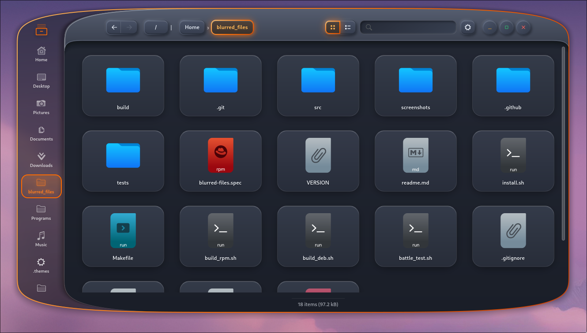
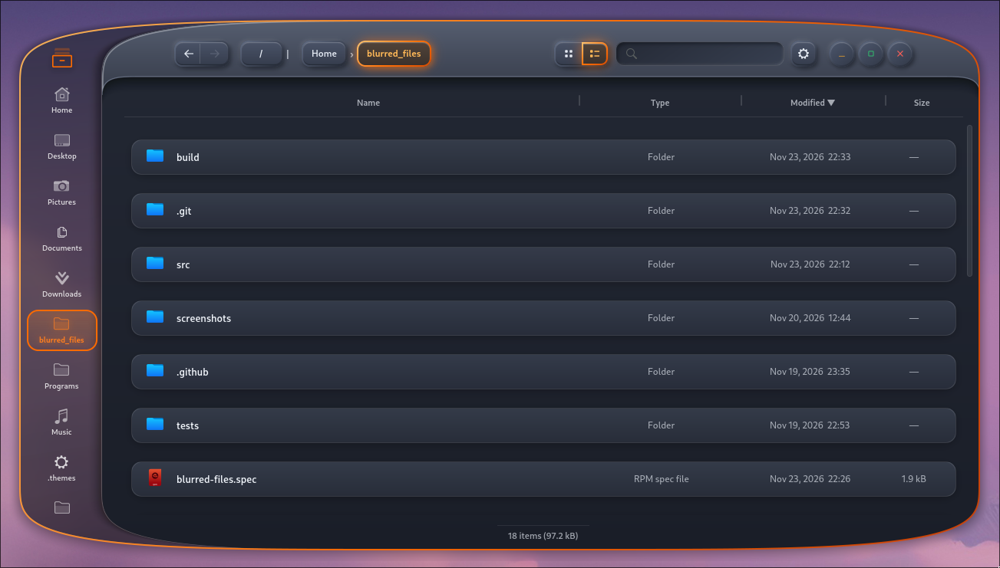

# Blurred Files

A fast, lightweight GTK4 file manager written in C from scratch, featuring a custom superellipse window silhouette, translucent Wayfire-blurred sidebar, dark slate Neumorphic controls, and a Wayland `wlr-layer-shell` desktop mode.

> **Note:** Blurred Files is currently in **beta**. While core file operations and automated tests are in place, please report any compositor-specific quirks or edge cases via GitHub Issues.




---

## Features

- **Custom Superellipse UI & Tactile Controls**
  - Borderless 8-way edge-resizable superellipse window silhouette
  - Translucent dark slate-charcoal sidebar designed for Wayland compositor blur (Wayfire)
  - 3D dark slate-grey concave header bar with Neumorphic buttons and warm orange hover/active glow
  - Smooth alpha-masked breadcrumb scrolling with right-click path copy
  - Wayland `wlr-layer-shell` background desktop icons mode (`blurred_files --desktop`)
- **Browsing & Views**
  - **Icon Grid View** with 5-tier zoom (`Ctrl` + Mouse Wheel or `Ctrl` + `+`/`-`/`0`) and **Detailed List View** with sortable, live-resizable columns (`Name`, `Type`, `Modified`, `Size`)
  - Async GPU-accelerated image thumbnail previews
  - Instant live search filtering (`Ctrl+F`), hidden file toggle (`Ctrl+H`), and directory change monitoring
  - Mouse side-button (`Back` / `Forward`) and keyboard navigation (`Alt+Left`, `Alt+Right`, `Backspace`)
- **File Operations & Productivity**
  - Multi-selection via rubberband drag marquee, `Ctrl+A`, or click selection
  - Full internal clipboard (`Ctrl+C`, `Ctrl+X`, `Ctrl+V`) and multi-step **Undo / Redo** (`Ctrl+Z`, `Ctrl+Y` / `Ctrl+Shift+Z`)
  - Drag-and-drop moving across folders, sidebar bookmarks, Trash, and external windows
  - Safe Trash management (`Delete`), item restoration, and non-blocking background **Empty Trash**
  - Built-in archive creation (`.zip`, `.tar.gz`) and one-click archive extraction
  - Custom dark-slate superellipse modals for **Properties** (`Space`), **Rename**, **New Folder / File** (`Ctrl+Shift+N`), **Open With**, and **Preferences**
  - Pinned favorite folders, external volume mounting/unmounting, and **Open in Terminal** (`Ctrl+Alt+T`)

---

## Installation

### Prerequisites

Install the GTK4 and `gtk4-layer-shell` development libraries and build tools:

- **openSUSE:**
  ```bash
  sudo zypper install -y gcc make pkg-config gtk4-devel gtk4-layer-shell-devel
  ```
- **Debian / Ubuntu:**
  ```bash
  sudo apt update && sudo apt install -y build-essential pkg-config libgtk-4-dev libgtk4-layer-shell-dev
  ```
- **Fedora:**
  ```bash
  sudo dnf install -y gcc make pkgconf-pkg-config gtk4-devel gtk4-layer-shell-devel
  ```

### Build & Install from Source

```bash
git clone https://github.com
cd Blurred-files
make -j\$(nproc)
sudo make install
```

Run the application from your app launcher or terminal:

```bash
blurred_files
```

Or launch background desktop icons mode on Wayland (`wlr-layer-shell`):

```bash
blurred_files --desktop
```

### Build `.deb` or `.rpm` Packages

- **Debian / Ubuntu (`.deb`):**
  ```bash
  ./build_deb.sh
  sudo apt install ./blurred-files_*.deb
  ```
- **openSUSE / Fedora (`.rpm`):**
  ```bash
  ./build_rpm.sh
  sudo zypper install ~/rpmbuild/RPMS/x86_64/blurred-files-*.rpm
  ```

### Running Automated Tests

```bash
make sanitize && make test
```

---

## License

This project is licensed under the **GNU General Public License v3.0 (GPL-3.0)** — see the [LICENSE](LICENSE) file for details.